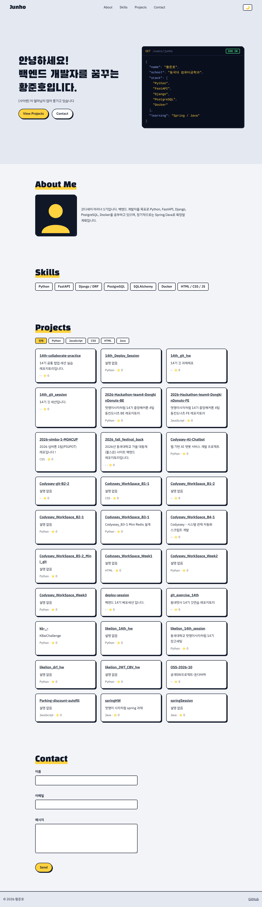
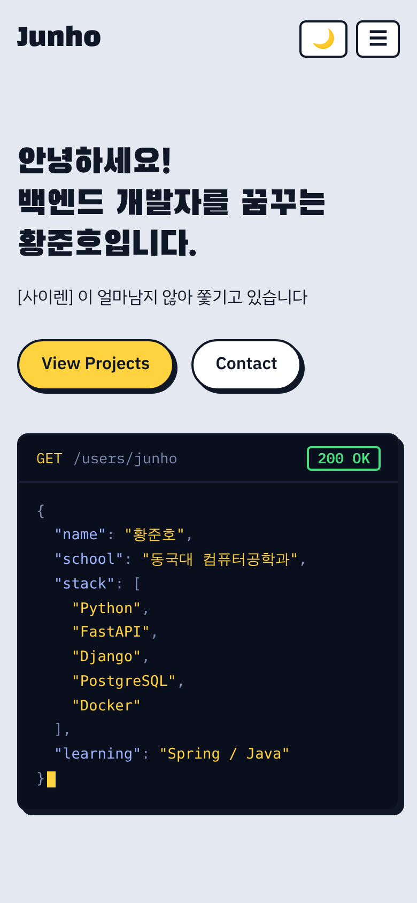
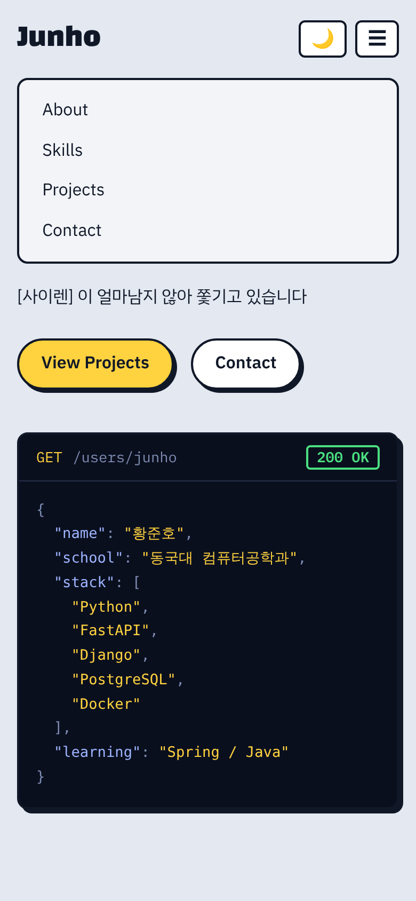
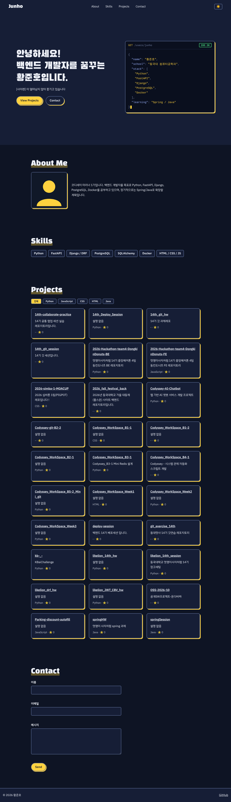

# 황준호 포트폴리오

순수 HTML/CSS/JavaScript로 만든 반응형 포트폴리오 웹사이트입니다.

## 배포 URL
https://junhnno.github.io/Codyssey_WorkSpace_B1-1/

## 사용 기술
- HTML5 (시맨틱 태그)
- CSS3 (CSS 변수, Flexbox, Grid, 미디어쿼리)
- JavaScript ES6+ (fetch, async/await, Intersection Observer, localStorage)
- 웹 폰트: Google Fonts (Black Han Sans, IBM Plex Sans KR, IBM Plex Mono)
- 외부 라이브러리 없음

## 주요 기능
- 반응형 레이아웃 (모바일 퍼스트, 768px / 1024px 브레이크포인트)
- 햄버거 메뉴, 부드러운 스크롤, 스크롤 탑 버튼
- 다크 모드 (localStorage 저장)
- 스크롤 애니메이션
- Contact 폼 유효성 검사 (필수값, 이메일 형식)
- GitHub API 연동 (로딩 / 성공 / 에러 + 재시도 / 빈 상태)
- 프로젝트 언어별 필터링 (`Array.filter` 사용, 보너스)
- 히어로 JSON 응답 타이핑 효과 (보너스, `prefers-reduced-motion` 설정 시 즉시 표시)
- 로딩/에러/빈 상태와 폼 결과를 HTTP 상태 코드(403, 204, 422 등)로 표시

## Flexbox와 Grid 선택 이유
- **네비게이션 = Flexbox**: 로고, 메뉴, 버튼을 한 줄(1차원)로 늘어놓고 양끝 정렬하는 용도라 Flexbox가 맞습니다.
- **프로젝트 카드 = Grid**: 카드를 행/열(2차원)로 배치하고, `auto-fit` + `minmax`로 화면 너비에 따라 열 수가 자동으로 바뀌어야 해서 Grid가 맞습니다.

## 기준값
| 항목 | 값 |
| --- | --- |
| 스크롤 탑 버튼 표시 | 스크롤 300px 이상 |
| 네비게이션 배경 변경 | 스크롤 60px 이상 |
| Intersection Observer threshold | 0.2 |

## 폴더 구조
```
index.html
css/style.css
js/main.js
images/profile.svg
images/screenshot-*.png
```

## 스크린샷

### 데스크톱


### 모바일


### 모바일 (햄버거 메뉴 열림)


### 다크 모드

